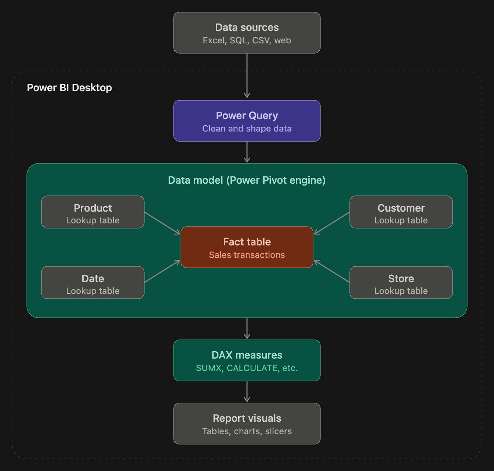
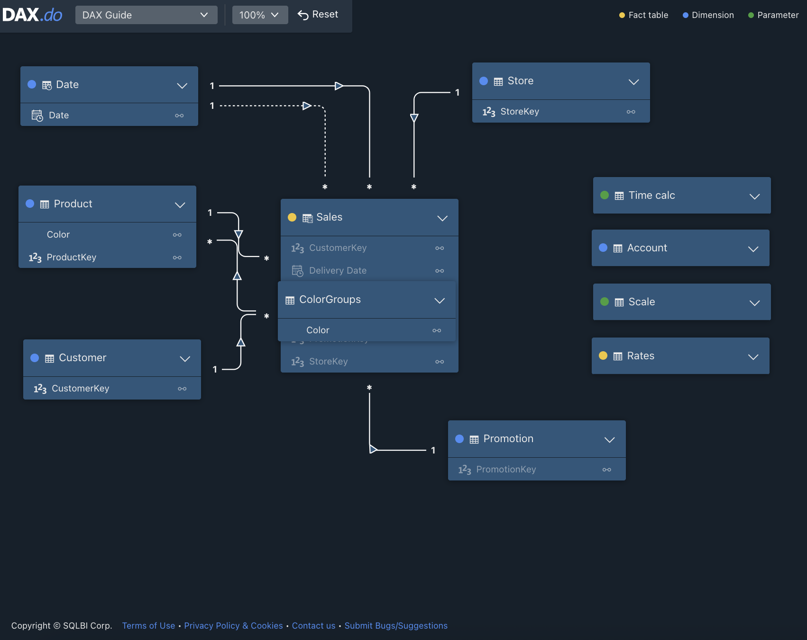

# DAX - PowerBi -- Beginner Guide
- This project is for a fellow colleague looking in better her understanding of PowerBi and the functinos it runs on.

## How It All Connects
- In Power BI, everything starts with **Power Query**, which pulls in your data and cleans it up (removing columns, fixing data types, merging files) before loading it into your model. 

- That data is organized as a **star schema**: one central "fact" table holds the transactions, like Sales, and surrounding "lookup" tables describe things like Product, Customer, and Date, each linked to the fact table by a one-to-many relationship. 

- The **Power Pivot** engine stores all of these tables and relationships in memory, and this is what people mean by "the data model." **DAX** is the formula language that runs on that model, so a measure like `SUMX` or `CALCULATE` can filter Sales just by filtering Product, because the relationship passes the filter along. 

- Finally, **Power BI** ties it together by showing those DAX measures in tables, charts, and slicers, and every slicer click changes what the measures calculate.

## What the code does
- We will be using https://dax.do/ to learn the functions and understand of how we tables are created and interact with each other. From there we still start diggin 

## How it shows the data
There are 11 tables ranging from Sales (accounting data), Date (datetime), Customer (unique IDs), and so on.

## Why it’s important
- To help the community!

## How to Run
- TBD